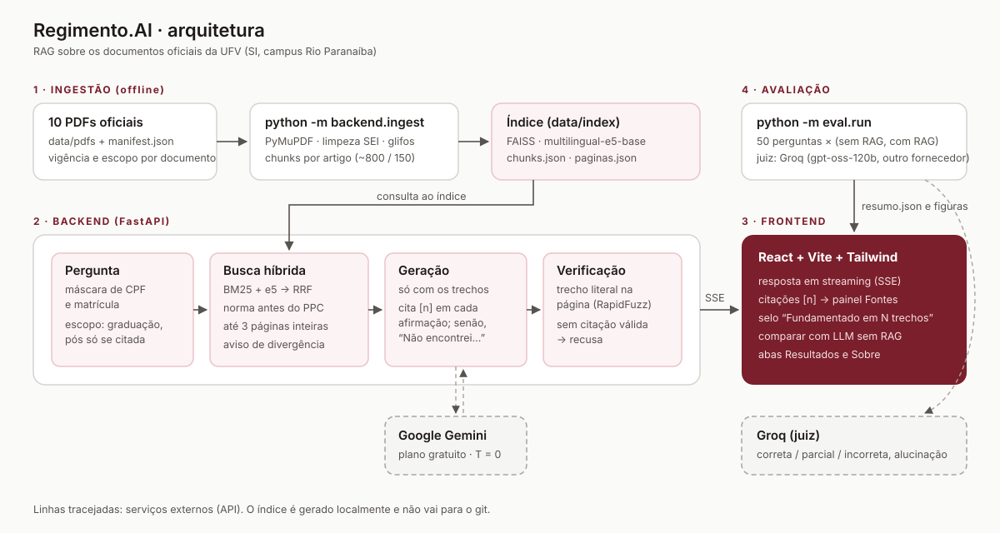
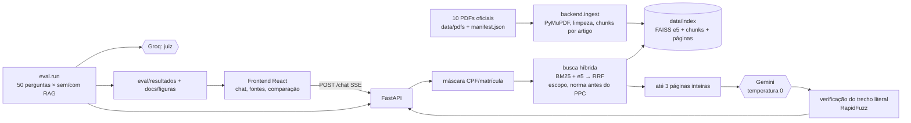
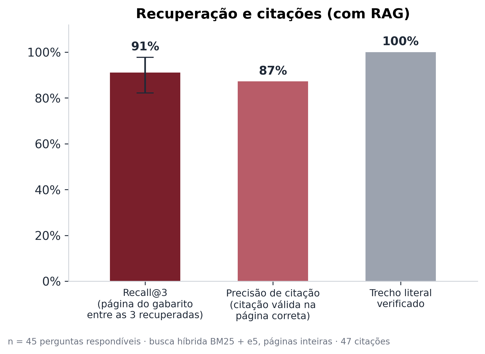

# Regimento.AI

Assistente acadêmico com **RAG** sobre os documentos oficiais da UFV, para estudantes de **Sistemas de Informação do campus Rio Paranaíba**. Responde só com base nos documentos, cita página e artigo de cada afirmação e diz "Não encontrei isso nos documentos oficiais" quando não há base. Um experimento compara o mesmo LLM com e sem RAG.

> As respostas não substituem a coordenação do curso nem o Registro Escolar. Em caso de dúvida, vale o documento oficial.

## O problema

As regras que um estudante precisa (trancamento, pré-requisitos, atividades complementares, extensão, prazos do calendário, TCC) estão espalhadas em 10 PDFs de anos diferentes, alguns com mais de 200 páginas, e às vezes se contradizem. Um LLM genérico responde com segurança, mas sem fonte e muitas vezes errado. O Regimento.AI só responde com trechos dos documentos e mostra o trecho literal de onde tirou cada informação.

## Arquitetura





| Pasta | Conteúdo |
|---|---|
| `backend/` | ingestão, busca híbrida, prompts, provedores (Gemini, Groq), verificação de citações, API FastAPI, testes |
| `frontend/` | React + Vite + TypeScript + Tailwind |
| `data/pdfs/` | os 10 PDFs oficiais e o `manifest.json` (título, vigência, escopo, páginas excluídas) |
| `data/index/` | índice gerado (fora do git) |
| `eval/` | banco de 50 perguntas, juiz, experimento, métricas, gráficos e resultados |
| `docs/` | especificação (`docs/spec/`) e figuras |

## Como rodar (Windows)

Requisitos: Python 3.12 e Node.js 20+.

```powershell
copy .env.example .env      # preencha GEMINI_API_KEY e GROQ_API_KEY (planos gratuitos)
powershell -ExecutionPolicy Bypass -File .\run.ps1
```

O `run.ps1` instala o que faltar, gera o índice na primeira vez (cerca de 20 minutos em CPU), sobe o backend em `http://127.0.0.1:8000` e o frontend em `http://127.0.0.1:5173` e abre o navegador. Ctrl+C encerra os dois.

Sem `.env`, a interface abre, mas o chat só responde as perguntas sugeridas que estiverem em `data/cache/sugeridas.json` (modo demonstração). Para gerar esse cache com respostas reais: `python -m backend.build_cache`.

Para ver os modelos que suas chaves enxergam no plano gratuito: `python -m backend.listar_modelos` (os nomes mudam com frequência; ajuste `GEMINI_MODEL` e `GROQ_MODEL` no `.env`).

## Como reindexar

```powershell
python -m backend.download_model    # só na primeira vez
python -m backend.ingest            # reconstrói data/index do zero
python -m backend.ingest --dry-run  # só extrai e gera o relatório
```

O relatório `data/index/ingest_report.json` mostra, por documento, as páginas indexadas, excluídas (9 páginas escaneadas do PPC) e ignoradas, o ruído removido e os glifos remapeados. Para adicionar um documento, coloque o PDF em `data/pdfs/`, registre-o no `manifest.json` e rode a ingestão. Atalho: `.\run.ps1 -Reindexar`.

## Como rodar a avaliação

```powershell
python -m eval.validar_perguntas   # confere o banco de perguntas (evidência literal em cada página)
python -m eval.run                 # experimento completo: 50 × (sem RAG, com RAG) + juiz
python -m eval.run --so-recuperacao  # só o recall@3, sem LLM e sem chave
python -m pytest                   # testes (sem rede)
```

O `eval.run` grava o progresso depois de cada chamada em `eval/resultados/progresso.json`. Se o plano gratuito bater no limite (429), ele para e você roda de novo para continuar. Saídas: `eval/resultados/<data>.csv`, `eval/resultados/resumo.json` e as figuras em `docs/figuras/` (PNG 300 dpi + SVG).

Para medir a busca isoladamente: `python -m backend.medir_recuperacao` (hit@1 e hit@3 de 7 consultas de validação por modo de busca).

## Resultados



| Métrica | Valor | Situação |
|---|---|---|
| **Recall@3** (página do gabarito entre as 3 páginas recuperadas) | **41/45 = 91,1%** (IC 95%: 82,2% a 97,8%) | medido |
| Busca, 7 consultas de validação: hit@3 | denso 5/7 → híbrido 6/7 | medido |
| Busca, 7 consultas de validação: hit@1 | denso 4/7 → híbrido 3/7 | medido |
| Alucinação sem RAG × com RAG | — | pendente |
| Acurácia sem RAG × com RAG | — | pendente |
| Recusa correta (5 perguntas sem resposta) | — | pendente |
| Precisão de citação | — | pendente |

Os itens pendentes dependem do LLM: o experimento ainda não foi rodado com as chaves de API. Com o `.env` preenchido, `python -m eval.run` completa a tabela e gera os gráficos de alucinação (com IC 95% bootstrap) e de acurácia por categoria. Nenhum desses números foi estimado.

O gabarito das 50 perguntas ainda **não foi revisado por um humano** (`revisado: false`), então todos os números são preliminares.

## Limitações

- Cobre só os 10 documentos indexados. Normas mais novas ou de outros cursos não estão incluídas.
- Os documentos têm vigências diferentes (2021 a 2026) e se contradizem em pontos conhecidos, por exemplo a carga de atividades complementares (210 h-a no regulamento × 60 h-a no PPC) e o código da disciplina (SIN496 × SIN 494). O sistema avisa a divergência e cita as duas fontes em vez de escolher.
- As 9 páginas escaneadas do PPC (ata do CEPE) ficaram fora do índice (sem OCR). O PDF da Resolução de extensão tem erros de OCR na origem.
- Busca: o calendário repete as mesmas frases a cada semestre e o PPC repete informações em várias páginas, o que causa as 4 falhas de recall@3. O hit@1 do híbrido não melhorou em relação ao denso.
- 50 perguntas dão intervalos de confiança largos. Os resultados não generalizam para outros cursos.
- Modelos de linguagem podem errar mesmo com as fontes. Confira sempre a página citada.

## Privacidade

Não digite dados pessoais. CPF e número de matrícula são mascarados antes do envio ao LLM, mas outros dados não são. No plano gratuito do Gemini, o Google pode usar os dados enviados para melhorar seus produtos. O sistema não guarda histórico de conversas.

## Documentação

A especificação completa (requisitos, design e tarefas, com as decisões e medições de cada etapa) está em [`docs/spec/`](docs/spec/).
