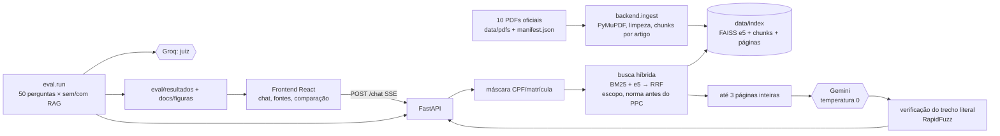
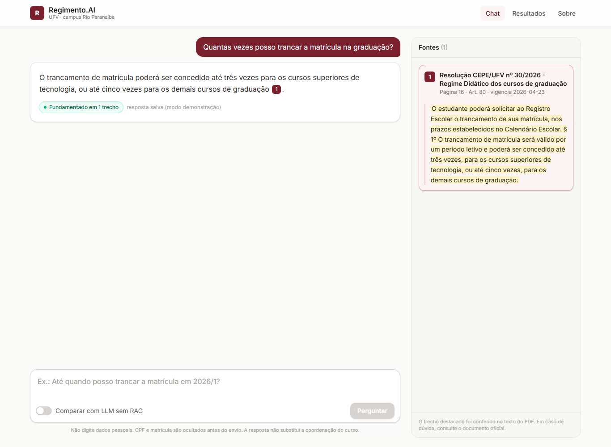
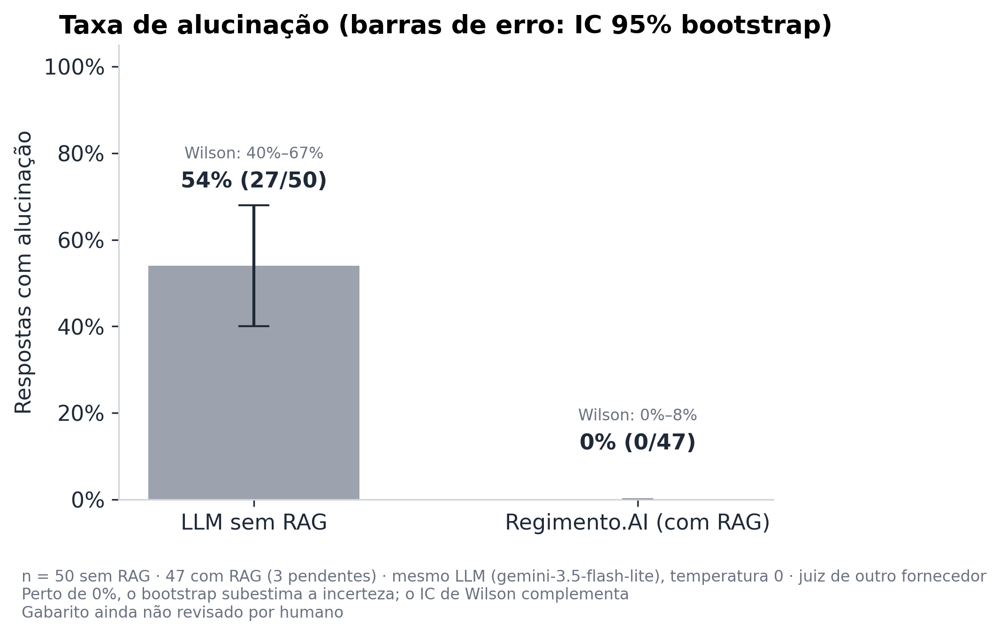
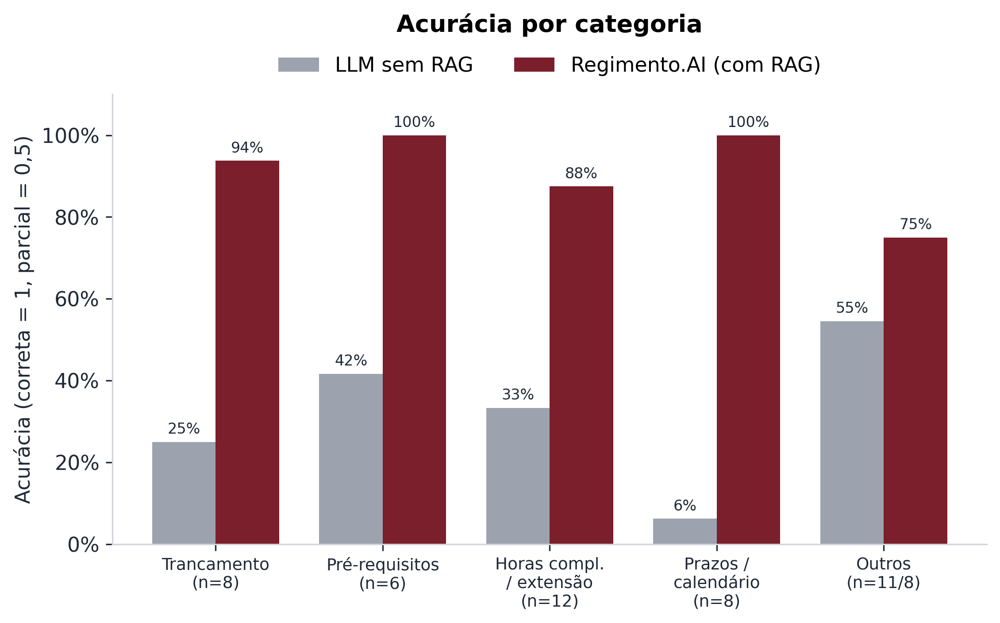

# Regimento.AI

Assistente acadêmico com **RAG** sobre os documentos oficiais da UFV, para estudantes de **Sistemas de Informação do campus Rio Paranaíba**. Responde só com base nos documentos, cita página e artigo de cada afirmação e diz "Não encontrei isso nos documentos oficiais" quando não há base. Um experimento compara o mesmo LLM com e sem RAG.

> As respostas não substituem a coordenação do curso nem o Registro Escolar. Em caso de dúvida, vale o documento oficial.

## O problema

As regras que um estudante precisa (trancamento, pré-requisitos, atividades complementares, extensão, prazos do calendário, TCC) estão espalhadas em 10 PDFs de anos diferentes, alguns com mais de 200 páginas, e às vezes se contradizem. Um LLM genérico responde com segurança, mas sem fonte e muitas vezes errado. O Regimento.AI só responde com trechos dos documentos e mostra o trecho literal de onde tirou cada informação.

## Arquitetura




| Pasta | Conteúdo |
|---|---|
| `backend/` | ingestão, busca híbrida, prompts, provedores (Gemini, Groq), verificação de citações, API FastAPI, testes |
| `frontend/` | React + Vite + TypeScript + Tailwind |
| `data/pdfs/` | os 10 PDFs oficiais e o `manifest.json` (título, vigência, escopo, páginas excluídas) |
| `data/index/` | índice gerado (fora do git) |
| `eval/` | banco de 50 perguntas, juiz, experimento, métricas, gráficos e resultados |
| `docs/` | especificação (`docs/spec/`) e figuras |

## Como rodar (Windows)

Requisitos: Python 3.12 e Node.js 20+.

```powershell
copy .env.example .env      # preencha GEMINI_API_KEY e GROQ_API_KEY (planos gratuitos)
powershell -ExecutionPolicy Bypass -File .\run.ps1
```

O `run.ps1` instala o que faltar, gera o índice na primeira vez (cerca de 20 minutos em CPU), sobe o backend em `http://127.0.0.1:8000` e o frontend em `http://127.0.0.1:5173` e abre o navegador. Ctrl+C encerra os dois.

Sem `.env`, a interface abre, mas o chat só responde as perguntas sugeridas que estiverem em `data/cache/sugeridas.json` (modo demonstração). Para gerar esse cache com respostas reais: `python -m backend.build_cache`.

Para ver os modelos que suas chaves enxergam no plano gratuito: `python -m backend.listar_modelos` (os nomes mudam com frequência; ajuste `GEMINI_MODEL` e `GROQ_MODEL` no `.env`). Configuração usada no experimento: `GEMINI_MODEL=gemini-3.5-flash-lite` (os Flash "cheios" têm cota diária baixa no plano gratuito) e `GROQ_MODEL=openai/gpt-oss-120b`.



Dica: `http://127.0.0.1:5173/?q=sua+pergunta` abre o chat já com a pergunta enviada.

## Como reindexar

```powershell
python -m backend.download_model    # só na primeira vez
python -m backend.ingest            # reconstrói data/index do zero
python -m backend.ingest --dry-run  # só extrai e gera o relatório
```

O relatório `data/index/ingest_report.json` mostra, por documento, as páginas indexadas, excluídas (9 páginas escaneadas do PPC) e ignoradas, o ruído removido e os glifos remapeados. Para adicionar um documento, coloque o PDF em `data/pdfs/`, registre-o no `manifest.json` e rode a ingestão. Atalho: `.\run.ps1 -Reindexar`.

## Como rodar a avaliação

```powershell
python -m eval.validar_perguntas   # confere o banco de perguntas (evidência literal em cada página)
python -m eval.run                 # experimento completo: 50 × (sem RAG, com RAG) + juiz
python -m eval.run --so-recuperacao  # só o recall@3, sem LLM e sem chave
python -m pytest                   # testes (sem rede)
```

O `eval.run` grava o progresso depois de cada chamada em `eval/resultados/progresso.json`. Se o plano gratuito bater no limite (429), ele para e você roda de novo para continuar. Saídas: `eval/resultados/<data>.csv`, `eval/resultados/resumo.json` e as figuras em `docs/figuras/` (PNG 300 dpi + SVG).

Para medir a busca isoladamente: `python -m backend.medir_recuperacao` (hit@1 e hit@3 de 7 consultas de validação por modo de busca).

## Resultados

> **Números preliminares:** o gabarito das 50 perguntas foi gerado a partir dos PDFs e ainda **não foi revisado por um humano** (`revisado: false`).

Experimento de 11 e 12/11/2026: as mesmas 50 perguntas (45 com resposta nos documentos, 5 sem) respondidas pelo **mesmo LLM** (`gemini-3.5-flash-lite`, plano gratuito, temperatura 0) **sem RAG** e **com RAG**, julgadas por um modelo de outro fornecedor (`openai/gpt-oss-120b` no Groq; a conta não tinha Llama grande de chat disponível).

> **Execução incompleta no modo com RAG:** depois da melhoria do retriever (v2), o modo com RAG foi refeito por inteiro. As 50 respostas foram geradas, mas **3 julgamentos (Q43, Q44, Q45) ficaram pendentes** porque o juiz bateu na cota do plano gratuito do Groq. Os números com RAG v2 abaixo são sobre **47 perguntas julgadas** (42 com resposta + 5 sem). Para concluir: `python -m eval.run` (continua de onde parou).



| Métrica | Sem RAG | Com RAG, retriever v1 | **Com RAG, retriever v2 (atual)** |
|---|---|---|---|
| **Alucinação** | **54% (27/50)** · IC 95% bootstrap 40–68% · Wilson 40,4–67,0% | 2% (1/50) · Wilson 0,4–10,5% | **0% (0/47)** · Wilson 0–7,6% |
| **Acurácia** (correta = 1, parcial = 0,5) | **33,3%** (45) · IC 95% 22–46% | 85,6% (45) · IC 76–94% | **90,5%** (42) · IC 81–98% |
| Acurácia estrita (só "correta") | 22,2% (10/45) | 80,0% (36/45) | **88,1% (37/42)** |
| **Recusa correta** (5 sem resposta) | **0/5** | 5/5 | **5/5** |
| Recusa indevida | 0/45 | 3/45 (Q07, Q26, Q27) | 3/42 (Q26, Q40, Q42) |
| **Recall@3** (página do gabarito entre as 3 do ranking) | — | 91,1% (41/45) | **91,1% (41/45)** · IC 82–98% |
| **Recall no contexto** (inclui as páginas obrigatórias) | — | 91,1% | **95,6% (43/45)** |
| **Precisão de citação** (válida e na página do gabarito) | — | 87,2% (41/47) | **83,3% (40/48)** |
| Trecho literal confirmado no PDF | — | 100% | **100% (48/48)** |




### Retriever v2: o que mudou

Duas regras de **páginas obrigatórias**, que entram no contexto além das 3 páginas do ranking:

1. **Calendário por semestre.** Quando a pergunta cita um semestre (2026/1, "primeiro semestre"), um prazo, uma data ou palavras como "quando", "início" e "último dia", entra a página do calendário daquele semestre. O semestre de cada página sai dos cabeçalhos de mês (março a julho = 2026/1). A página é escolhida por e5 + BM25 só dentro daquele semestre, com sinônimos de calendário ("começa" → "início") e prioridade para trechos com a mesma sequência de palavras da pergunta.
2. **Conflito com o PPC.** Quando o regulamento de atividades complementares ou a resolução de extensão é recuperado, entra a página do corpo do PPC sobre o mesmo tema (todas as páginas do trecho, se ele atravessar duas), para o modelo poder apontar a divergência.

O que isso consertou e o que piorou, pergunta a pergunta:

| Pergunta | v1 | v2 |
|---|---|---|
| Q07: trancar em 2026/2 sem assinatura | recusou | **correta**: "18 de setembro de 2026", cita calendário p. 7 |
| Q15: carga de atividades complementares (conflito) | parcial: só 210 h-a | **correta**: aponta 210 h-a (regulamento, 2021) × 60 h-a (PPC, 2022) |
| Q24: disciplina das atividades complementares (conflito) | parcial: só SIN496 | **correta**: aponta SIN496 (regulamento) × SIN 494 (PPC) |
| Q27: início de 2026/1 | recusou | **correta**: "02 de março de 2026", cita calendário p. 3 |
| Q26: horas optativas | recusou | recusou (nenhuma regra se aplica; a página do PPC não é recuperada) |
| Q18: horas por artigo completo | correta | **parcial**, efeito colateral da regra 2: o PPC entrou, o modelo falou de divergência e omitiu o limite de 90 h-a |
| Q40 e Q42 (TCC) | corretas | recusas: contexto idêntico ao v1; o verificador descartou a resposta. Ao reproduzir, as duas passaram. Variação do modelo, não do retriever |

Fora do banco, a pergunta "Até quando posso trancar a matrícula em 2026/1?" agora responde "10 de abril (sem depender da assinatura dos professores) e 21 de maio (com comprovação de frequência)" e cita o calendário, p. 4.

Como ler:

- **Sem RAG**, o modelo responde tudo com segurança, inclusive as 5 perguntas sem resposta nos documentos (0/5 recusas corretas), e inventa números em mais da metade das respostas. Exemplo: dá "quatro semestres" de trancamento, quando o Regime Didático diz até cinco vezes. A pior categoria é prazos/calendário (6%); com RAG v2 ela vai a 100%.
- A **precisão de citação é conservadora**: várias citações "fora da página do gabarito" estão certas, porque o PPC repete conteúdo em várias páginas. Ela caiu no v2 porque o modelo passou a citar também as páginas obrigatórias do PPC.
- **Temperatura 0 não garante a mesma resposta**: Q40 e Q42 mudaram sem nenhuma mudança no contexto. A partir desta versão, o texto descartado pelo verificador fica salvo (`resposta_descartada`) para auditoria.
- Busca, 7 consultas de validação (`python -m backend.medir_recuperacao`): hit@3 de 5/7 (só e5) para 6/7 (híbrido); hit@1 de 4/7 para 3/7.

Detalhes, por pergunta, em `eval/resultados/2026-11-12.csv` e `eval/resultados/resumo.json`.

## Limitações

- Cobre só os 10 documentos indexados. Normas mais novas ou de outros cursos não estão incluídas.
- Os documentos têm vigências diferentes (2021 a 2026) e se contradizem em pontos conhecidos, por exemplo a carga de atividades complementares (210 h-a no regulamento × 60 h-a no PPC) e o código da disciplina (SIN496 × SIN 494). O sistema avisa a divergência e cita as duas fontes em vez de escolher.
- As 9 páginas escaneadas do PPC (ata do CEPE) ficaram fora do índice (sem OCR). O PDF da Resolução de extensão tem erros de OCR na origem.
- Busca: o calendário repete as mesmas frases a cada semestre e o PPC repete informações em várias páginas, o que causa as 4 falhas de recall@3. O hit@1 do híbrido não melhorou em relação ao denso. As páginas obrigatórias (retriever v2) resolvem o calendário e os conflitos conhecidos, mas são regras específicas deste corpus e trazem páginas a mais quando não precisam (ver Q18).
- 50 perguntas dão intervalos de confiança largos. Os resultados não generalizam para outros cursos.
- O juiz é um LLM (`gpt-oss-120b`, prompt versionado em `eval/judge_prompt_v1.md`) e erra às vezes: a Q37 foi julgada alucinação no v1 e correta no v2, com respostas equivalentes. Não houve revisão humana dos vereditos.
- O plano gratuito limita o uso: o juiz no Groq tem 200 mil tokens por dia, e o experimento completo quase esgotou essa cota. O `eval.run` para com o progresso salvo e continua de onde parou.
- Modelos de linguagem podem errar mesmo com as fontes. Confira sempre a página citada.

## Privacidade

Não digite dados pessoais. CPF e número de matrícula são mascarados antes do envio ao LLM, mas outros dados não são. No plano gratuito do Gemini, o Google pode usar os dados enviados para melhorar seus produtos. O sistema não guarda histórico de conversas.

## Documentação

A especificação completa (requisitos, design e tarefas, com as decisões e medições de cada etapa) está em [`docs/spec/`](docs/spec/).
