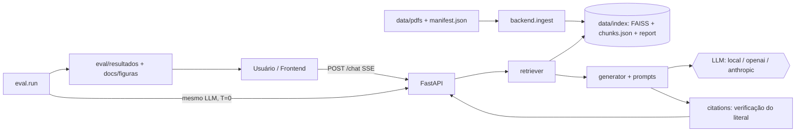

# Regimento.AI — Design

Status: **APROVADA**. Referência: `requirements.md` (R*).

## 1. Visão geral



Decisões-chave:

- **Monorepo** com `backend/` (Python 3.12) e `frontend/` (Node 25 já instalado, Vite). Docker 29 já instalado.
- **Índice em disco, gerado**: `data/index/` não é versionado. Quem clona roda `python -m backend.ingest`.
- **Um único contrato de citação** usado pelo backend, pela avaliação e pelo frontend.
- **Recusa é resultado válido**: o sistema prefere dizer que não achou a inventar.

## 2. Estrutura de pastas (alvo da Etapa 1)

```
regimento-ai/
├── backend/
│   ├── __init__.py
│   ├── config.py          # Settings (pydantic-settings) lendo .env
│   ├── ingest.py          # python -m backend.ingest
│   ├── extract.py         # PyMuPDF, limpeza SEI, remapeamento PUA, OCR
│   ├── chunking.py        # chunks por artigo
│   ├── indexer.py         # e5 + FAISS, gravação em data/index
│   ├── retriever.py
│   ├── prompts.py
│   ├── generator.py       # providers: local, openai, anthropic
│   ├── citations.py       # verificação do trecho_literal
│   ├── schemas.py         # modelos Pydantic
│   ├── main.py            # FastAPI
│   └── tests/
├── frontend/
├── data/pdfs/             # + manifest.json
├── data/index/            # gerado (gitignore)
├── eval/
│   ├── perguntas.json
│   ├── judge_prompt_v1.md
│   ├── run.py             # python -m eval.run
│   ├── metrics.py
│   ├── plots.py
│   └── resultados/
├── docs/                  # spec e figuras
├── docker-compose.yml     # Etapa 7
├── .env.example
├── .gitignore
└── README.md
```

A spec é copiada para `docs/spec/` na Etapa 1 (R1.4: `docs/` contém a spec).

## 3. Ingestão (Etapa 2)

### 3.1 Fluxo

1. Ler `data/pdfs/manifest.json`; ignorar PDFs que não estejam nele e avisar.
2. Para cada PDF e página: extrair texto, limpar ruído, detectar páginas sem texto.
3. Detectar estrutura (artigos e parágrafos) e produzir **unidades** `(documento, pagina, artigo, texto)`.
4. Chunking por unidade.
5. Embeddings em lote (`passage: `), normalizados L2, índice `IndexFlatIP` (cosseno). O corpus tem ~370 págs e poucos milhares de chunks, então não precisa de índice aproximado.
6. Gravar `index.faiss`, `chunks.json` e `ingest_report.json`.

### 3.2 Tratamento dos problemas medidos

| Problema | Tratamento | Validação |
|----------|-----------|-----------|
| Doc 10 com glifos da área privada | Tabela de remapeamento inicial: `\ue044→t`, `\ue01c→t`, `\ue02e→f`, `\ue02f→fi`, `\ue046→ti`. A tabela é **inferida e conferida** em cada execução: para cada glifo privado, testar as candidatas contra um vocabulário português (palavras do próprio corpus extraído dos outros 9 PDFs) e escolher a que mais forma palavras válidas. | Falha se sobrar qualquer caractere U+E000 a U+F8FF, ou se menos de 90% das palavras do doc 10 estiverem no vocabulário. Em falha, cair para OCR do doc inteiro. |
| 9 páginas escaneadas do PPC (48 a 56) | OCR com Tesseract `por`, 300 dpi, via `pytesseract`. O texto vem com `origem: "ocr"` no metadado e confiança reduzida no selo. | Se o Tesseract não existir, a página vai para `paginas_ignoradas` no relatório (R2.5). |
| Ruído SEI | Regex nas linhas de topo e rodapé: `^\d{2}/\d{2}/\d{2}, \d{2}:\d{2}`, `SEI/UFV - \d+ - `, `https://sei\.ufv\.br\S+`, `\d+/\d+$`. Só aplicada às primeiras e últimas 3 linhas da página. | O relatório conta linhas removidas por documento. Teste: nenhum artigo perde texto. |
| Tabelas (AC, calendário) | Extrair com `page.find_tables()` e serializar cada linha como `coluna: valor`. Tabela inteira vira um chunk próprio se couber. | Pergunta de teste: "limite de monitoria" deve recuperar a linha certa. |

### 3.3 Detecção de artigo

- Regex: `^\s*Art\.?\s*(\d+)\s*[º°o]?` para início de artigo; `^\s*§\s*(\d+)\s*[º°]` e `^\s*Parágrafo único` para parágrafos.
- O campo `artigo` guarda o rótulo normalizado, p.ex. `"Art. 45"` ou `"Art. 45, § 2º"`.
- Um artigo pode atravessar páginas. A unidade mantém a **página onde o chunk começa** e guarda também `pagina_fim`.
- Documentos sem artigos (Catálogo, Colação, PPC fora dos anexos normativos) usam `artigo: null`, e o chunking cai para janelas de texto. Para o PPC, o rótulo da seção (ex.: "Anexo IV") vira `secao`.

### 3.4 Chunking

- Alvo 800 caracteres, overlap 150. Parâmetros em `config.py`.
- Se o artigo inteiro cabe em até ~1.000 caracteres, ele **não é cortado**. Acima disso, divide por parágrafo (§) e inciso, e cada chunk filho recebe o prefixo do artigo (`Art. 45 (cont.)`), para o trecho não perder o contexto.
- O texto indexado inclui um cabeçalho curto `[{titulo do doc} | {vigencia}]`, para o embedding distinguir, por exemplo, o calendário 2026 de um regulamento antigo.

### 3.5 Esquema de `chunks.json`

```json
{
  "id": "res30-2026-p12-c03",
  "documento": "res-cepe-30-2026",
  "titulo": "Resolução CEPE/UFV nº 30/2026 — Regime Didático",
  "vigencia": "2026-04-23",
  "escopo": "graduacao",
  "pagina": 12,
  "pagina_fim": 12,
  "artigo": "Art. 80",
  "secao": null,
  "origem": "texto",
  "texto": "..."
}
```

## 4. Recuperação e geração (Etapa 3)

### 4.1 Retriever

- Embeda `query: {pergunta}`, busca top-k (k=6, configurável), devolve chunks com `score` (cosseno).
- Filtro opcional por `escopo`. Padrão: não filtra, mas chunks de `pos-graduacao` ganham o aviso de escopo no contexto do prompt.
- Dedup por `(documento, pagina, artigo)` mantendo o melhor score.
- Limiar `MIN_SCORE` configurável. Abaixo dele, sem contexto, o fluxo vai direto para a recusa (R3.6). O valor é calibrado nas perguntas de dev, não fixado de cabeça.

### 4.2 Prompt (resumo)

```
Você é um assistente acadêmico da UFV (campus Rio Paranaíba, Sistemas de Informação).
Responda SOMENTE com base nos trechos numerados abaixo.
Cada afirmação deve terminar com a citação [n] do trecho que a sustenta.
Se os trechos não bastarem, responda exatamente: "Não encontrei isso nos documentos oficiais".
Se trechos de documentos diferentes divergirem, aponte a divergência e cite ambos com a vigência.
Se o trecho for de pós-graduação, avise que não se aplica à graduação.
Não use conhecimento externo.

[1] (Documento X, vigência Y, p. Z, Art. N) texto...
```

### 4.3 Providers

Interface única `generate_stream(messages, temperature) -> AsyncIterator[str]`.

| Provider | Implementação | Observação |
|----------|--------------|------------|
| `local` | `transformers` + `Qwen/Qwen2.5-3B-Instruct`, `TextIteratorStreamer` em thread | Carregamento preguiçoso no primeiro uso. Em CPU, lento. |
| `openai` | SDK oficial, streaming | Modelo via `.env`. |
| `anthropic` | SDK oficial, streaming | Modelo via `.env`. |

Dependências com versão fixa em `backend/requirements.txt`. `.env.example` lista `LLM_PROVIDER`, `LOCAL_MODEL`, `OPENAI_API_KEY`, `OPENAI_MODEL`, `ANTHROPIC_API_KEY`, `ANTHROPIC_MODEL`, `TOP_K`, `MIN_SCORE`, `CHUNK_SIZE`, `CHUNK_OVERLAP`, `FUZZY_THRESHOLD`.

### 4.4 API

```
POST /chat?modo=rag|sem_rag      body: {"pergunta": str}
  SSE:  event: token     data: {"texto": "..."}
        event: citacoes  data: [{id, documento, pagina, artigo, trecho_literal, score, valida, vigencia, escopo}]
        event: fim       data: {"recusa": bool, "n_trechos": int, "modo": "rag"}
        event: erro      data: {"codigo": str, "mensagem": str}
GET  /documentos         -> manifesto
GET  /health             -> {indice: {chunks, documentos}, provider, modelo_carregado}
```

`modo=sem_rag` não consulta o índice, não envia citações e usa o mesmo system prompt neutro (sem a regra de recusa), para medir o comportamento "cru" do LLM. O prompt exato fica versionado em `prompts.py`.

### 4.5 Verificação de citação (`citations.py`)

1. Parsear `[n]` da resposta e mapear para o chunk `n` do contexto.
2. Pedir ao LLM um `trecho_literal` curto? **Não.** Mais robusto: o backend extrai a janela do chunk de maior similaridade com a frase da resposta que contém `[n]` (rapidfuzz `partial_ratio`) e a devolve como `trecho_literal`.
3. `valida = True` se `trecho_literal` está no texto do chunk, por substring normalizada (minúsculas, sem espaços duplicados) ou `partial_ratio >= FUZZY_THRESHOLD` (padrão 90).
4. `[n]` que aponta para índice inexistente é descartado e a resposta é marcada `citacao_invalida`.
5. Se a resposta não é recusa e não tem nenhuma citação válida, o backend troca por recusa e registra o motivo em log (garante o critério de aceite 1).

## 5. Avaliação (Etapa 5)

- `eval.run` chama as funções internas do backend (sem HTTP) para reproduzir exatamente o mesmo pipeline, com `temperature=0`, e grava as respostas brutas.
- **Juiz**: prompt versionado `judge_prompt_v1.md` recebe pergunta, gabarito, resposta e (no RAG) os trechos. Devolve JSON `{veredito: correta|parcial|incorreta, alucinou: bool, motivo}`. O juiz roda com `temperature=0`. Recomendado usar um modelo diferente do avaliado.
- **Alucinação**: resposta com afirmação factual sem sustentação no gabarito nem nos trechos. Na pergunta não respondível, qualquer resposta que não seja recusa conta como alucinação.
- **Recusa correta**: pergunta com `respondivel: false` e resposta que recusa.
- **Precisão de citação (só RAG)**: (a) a página citada coincide com a `pagina` do gabarito (tolerância ±0, e registrar também a taxa com ±1 página); (b) `valida` do literal. A métrica é a fração de respostas respondíveis com pelo menos uma citação que cumpre (a) e (b).
- **IC 95%**: bootstrap percentil, 10.000 reamostragens, semente fixa.
- **Perguntas `conflito: true`**: aceitam qualquer um dos documentos conflitantes como correto, desde que a resposta cite a fonte. Entram também numa métrica à parte (a resposta apontou a divergência?).
- **Reprodutibilidade**: `resumo.json` grava `data`, `provider`, `modelo`, `juiz`, `versao_prompt_juiz`, `hash_perguntas`, `hash_indice`, `fracao_revisada`.
- **Atenção sobre N**: com 50 perguntas, os ICs serão largos. Isso é limitação a declarar no README, não esconder.

## 6. Frontend (Etapa 6)

Rotas: `/` Chat, `/avaliacao`, `/sobre`.

- **Estado do chat**: hook `useChatStream` abre `fetch` com `ReadableStream` (POST não funciona com `EventSource`), parseia os eventos SSE e atualiza a mensagem do assistente. Cancelamento por `AbortController`.
- **Citações**: `[n]` no texto viram botões; clicar abre o painel "Fontes" e destaca o `trecho_literal` dentro do texto do chunk com `<mark>`.
- **Selo de confiança**: `Fundamentado em N trechos` quando há ≥1 citação válida; `Não encontrado nos documentos` na recusa; aviso âmbar quando alguma citação tem `valida: false` ou `origem: ocr`.
- **Comparação**: com a chave ligada, dispara duas chamadas em paralelo (`rag` e `sem_rag`) e mostra duas colunas. O lado sem RAG leva um aviso fixo: "sem fontes verificáveis".
- **Tema**: tokens Tailwind (`vinho-700 #7A1F2B` como ponto de partida, a conferir com a identidade oficial da UFV), modo escuro por classe, Inter.
- **Avaliação**: Recharts (barras e IC como `ErrorBar`), tabela com filtros e ordenação, tudo lendo `resumo.json` servido por um endpoint estático ou copiado no build.
- **Acessibilidade**: `aria-live="polite"` na resposta em streaming, foco gerenciado ao abrir o painel, contraste AA nos dois temas, alvo de toque ≥ 44 px. Validação final com leitor de tela é manual.
- **Erros e carregamento**: esqueleto durante a recuperação, mensagem com ação de repetir em falha de rede ou de provedor.

## 7. Docker e README (Etapa 7)

- `backend/Dockerfile` (python:3.12-slim; modelos em volume para não inflar a imagem), `frontend/Dockerfile` (build Vite + nginx), `docker-compose.yml` com volume `./data` e `.env`.
- O `local` em contêiner sem GPU é lento. O compose documenta o uso de `openai` ou `anthropic` como padrão rápido.
- README conforme R7.2.

## 8. Testes (pytest)

| Área | Casos |
|------|-------|
| Ingestão | detecção de `Art.`/`§`; limpeza de ruído SEI preserva o texto normativo; remapeamento PUA resolve "Ar\ue044." para "Art."; página sem texto é reportada; chunk não corta artigo curto |
| Retriever | pergunta sobre monitoria devolve o chunk da tabela de AC no top-3; ordenação por score; limiar produz zero resultados para consulta sem relação |
| Citações | literal exato é válido; literal com espaços diferentes é válido; literal inventado é inválido; `[n]` fora de faixa é descartado; resposta sem citação válida vira recusa |

Os testes de recuperação usam um índice pequeno gerado em `tmp_path` com 2 ou 3 PDFs/fixtures, para não depender de baixar o modelo grande em toda execução (modelo de embeddings real só em um teste marcado `slow`).

## 9. Riscos

| Risco | Mitigação |
|-------|-----------|
| Conflito de conta GitHub (`pedro-aguila-hub` × `JFcamp`) | Resolver antes da Etapa 1 (pergunta em aberto 1) |
| Notebook de origem indisponível | Escrever o pipeline do zero seguindo esta spec |
| OCR indisponível | Registrar páginas ignoradas, não falhar em silêncio |
| LLM local lento ou sem GPU | Recomendar provedor remoto para a avaliação; fixar `temperature=0` |
| Banco de 50 perguntas pequeno | Declarar ICs largos; não generalizar |
| Juiz LLM enviesado | Prompt versionado, juiz distinto do avaliado, amostra revisada à mão |
| PDFs públicos com possíveis direitos | Confirmar antes do push público |

## 10. Notas da implementação (Etapa 2)

Decisões tomadas durante a ingestão, que refinam ou substituem trechos acima.

- **Sem OCR.** Tesseract não foi instalado (decisão do projeto). As páginas 48 a 56 do PPC são excluídas pelo manifesto (`paginas_excluidas`) e aparecem no `ingest_report.json`. Páginas sem texto que não estejam no manifesto vão para `paginas_ignoradas`.
- **Remapeamento de glifos** (seção 3.2) ficou assim: (1) glifo que vem logo após dígito em >= 90% das ocorrências é o ordinal "º" (caso do PPC, `U+F06F`); (2) os demais são inferidos testando candidatas (`t`, `f`, `fi`, `fl`, `ti`, `tí`...) contra um vocabulário formado pelas palavras dos documentos sem glifos privados, mais `VOCAB_EXTRA` (termos latinos/ingleses e três palavras raras conferidas na página renderizada). Só conta como evidência palavra com 3 ou mais letras fora do glifo. Glifo ambíguo ou sem evidência interrompe a ingestão com `ErroRemapeamento` (código de saída 2) e mantém o índice anterior; não há fallback para OCR.
- **PDF de extensão (Res. CEPE 6/2022)** é digitalizado com camada de OCR, e o "º" aparece como "2" ("Art. 32" = Art. 3º). A numeração é corrigida pela sequência esperada.
- **Tabelas:** não foi usado `find_tables()`. A ordem natural de leitura do PyMuPDF já mantém cada linha da tabela de atividades complementares junta (conferido no chunk de "Monitoria").
- **Títulos** de capítulo e seção (`CAPÍTULO`, `Seção`, `TÍTULO`) vão no chunk do artigo seguinte, não no anterior.
- **Limpeza:** além das regex do SEI, remove-se linha de borda (4 primeiras e 4 últimas) cujo texto, ignorando dígitos, se repete em >= 60% das páginas, em documentos com 4 páginas ou mais.
- **`paginas.json`** guarda o texto limpo de cada página indexada, para a recuperação por página inteira da Etapa 3 (como no notebook de origem).
- **Ambiente:** `backend/__init__.py` define `USE_TF=0`, porque o TensorFlow instalado na máquina atrasava o import do `transformers` por minutos. `python -m backend.download_model` baixa só os arquivos necessários do e5 (os `.eval_results/*.yaml` do repositório exigem symlink, que o Windows nega sem privilégio de administrador).
- **Desempenho:** em CPU (i5-10210U), os embeddings dos ~1.370 chunks levam ~20 minutos.
- **Verificação do índice (7 consultas reais, `multilingual-e5-base`):** nas consultas com trecho esperado, ele aparece no top 3 em 3 de 4 casos problemáticos (posições 2 ou 3); os scores do e5 ficam numa faixa estreita (0,82 a 0,89), então o limiar `MIN_SCORE` da Etapa 3 precisa ser calibrado com dados, não escolhido de cabeça. Casos a tratar no retriever: (a) o chunk curto do Art. 4 das atividades complementares ("210 horas/aula") não aparece nem no top 30, mas o Art. 5, da mesma página, é o #2, então a **recuperação por página inteira** (como no notebook de origem) resolve; (b) o PPC repete o texto das atividades complementares e compete com o regulamento (conflito já previsto na seção 1.3 dos requisitos); (c) perguntas de graduação recuperam a pós-graduação no top 1, e o contrário também, então o retriever deve usar o `escopo` (aviso no contexto e, se necessário, filtro ou reordenação).
- **Retomada:** `data/index/emb_cache.npz` guarda os embeddings por bloco (chave = modelo + texto); uma ingestão interrompida continua de onde parou. O FAISS é gravado via `serialize_index`, porque o `write_index` não abre caminhos com acento no Windows (`Área de Trabalho`).